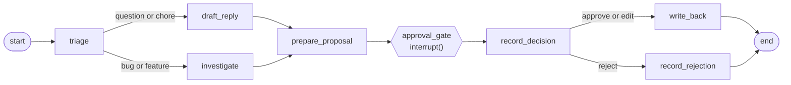

# poc-langgraph-swe-tickets

A proof of concept of one agentic pattern in one framework: a **human-in-the-loop approval
gate**, built with **LangGraph**, processing **software engineering tickets**.

An agent triages each ticket, reads the codebase and drafts a fix plan and patch. Then the
graph stops. Nothing is written back to the ticket until a person approves, edits or
rejects, and a pending approval survives process restarts.

> Work in progress. The agent core, API and UI are here. Infrastructure and full documentation
> follow in a later pull request.

## The graph



## Try it

Requires Python 3.12, [uv](https://docs.astral.sh/uv/) and Node 20.19 or later. Everything runs
offline against a fake LLM.

```sh
make dev
```

Open http://localhost:5173, enter your name and choose **Fetch tickets**. Approved write-backs
go to `data/write_backs.jsonl`, not to GitHub. `make check` runs the linters and tests.

`src/ticketgate/graph.py` is the place to start reading.

## Licence

MIT
