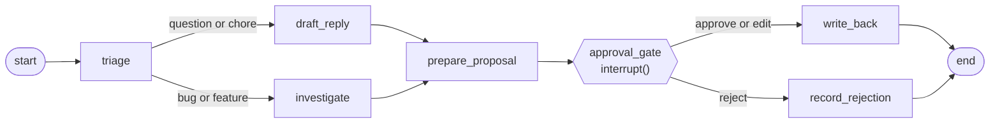

# poc-langgraph-swe-tickets

A proof of concept of one agentic pattern in one framework: a **human-in-the-loop approval
gate**, built with **LangGraph**, processing **software engineering tickets**.

An agent triages each ticket, reads the codebase and drafts a fix plan and patch. Then the
graph stops. Nothing is written back to the ticket until a person approves, edits or
rejects, and a pending approval survives process restarts.

> Work in progress. This first milestone is the agent core. The API, UI, infrastructure and
> full documentation follow in later pull requests.

## The graph



## Try it

Requires Python 3.12 and [uv](https://docs.astral.sh/uv/). Everything runs offline against a
fake LLM.

```sh
make install
make check
```

`src/ticketgate/graph.py` is the place to start reading.

## Licence

MIT
