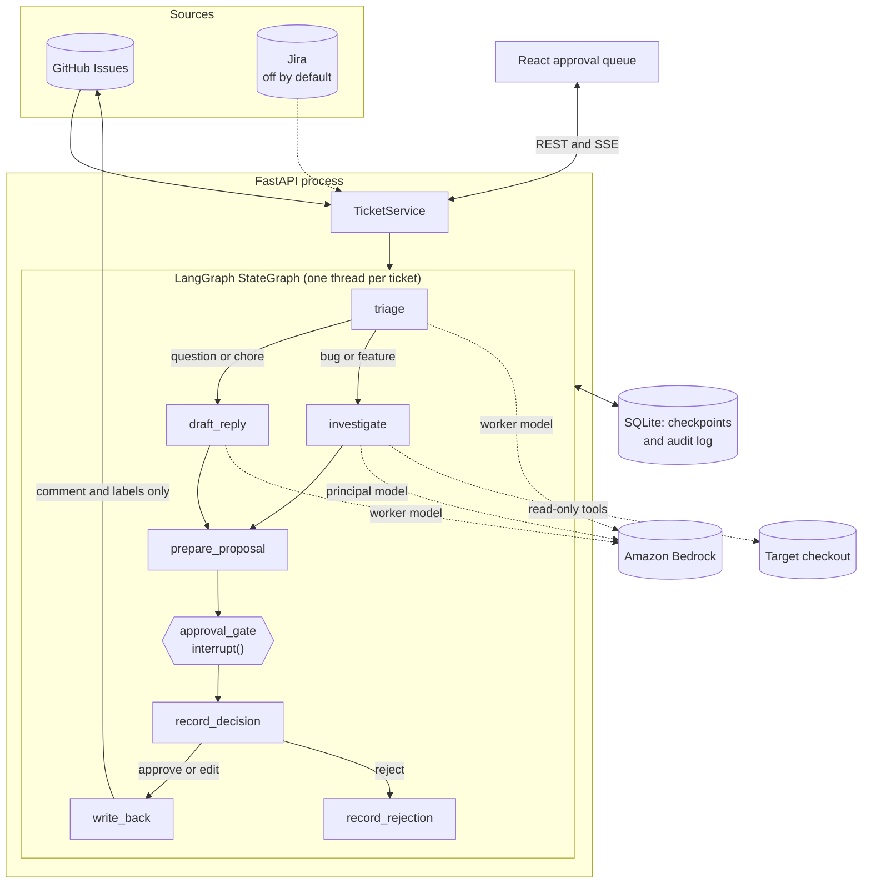

# poc-langgraph-swe-tickets

A proof of concept of one agentic pattern in one framework: a **human-in-the-loop approval gate**, built with **LangGraph**, processing **software engineering tickets**.

An agent triages each ticket, reads the codebase and drafts a fix plan and patch. Then the graph stops. Nothing is written back to the ticket until a person approves, edits or rejects it, and a pending approval survives process restarts.

It is a teaching example, not a product. Read [Limitations](#limitations) before running it against anything you care about.

## The pattern

An approval gate lets an agent do the slow, reversible work (reading, analysing, drafting) while a person keeps the irreversible step (acting on the outside world). The agent's run stops at a durable checkpoint and holds no process open while it waits, so the wait can last minutes or weeks.

**Use it when:**

- An action is hard to undo or visible to other people, such as a public comment, a payment or a deployment.
- A reviewer can judge the proposal much faster than they could produce it.
- You need a record of who approved what.
- You are building trust in an agent, and want to see how often its proposals survive review.

**Don't use it when:**

- Actions are cheap to reverse. Let the agent act, and audit afterwards.
- Volume is too high for anyone to read each proposal properly. Reviewers who approve without reading give you the delay and no safety. Consider sampling, or gating only high-risk cases.
- Decisions must happen in milliseconds.
- The reviewer can't actually evaluate the output. A gate doesn't help if the person has no way of telling a good patch from a bad one.

## Architecture



The investigator is its own small graph: `agent` calls read-only `tools` in a loop until it calls `submit_investigation`, gets a nudge if it replies in plain text, and stops at a step budget. A stopped investigation still reaches the gate, marked incomplete.

## How LangGraph expresses the pattern

| The pattern needs | LangGraph gives you | Where |
|---|---|---|
| Stop and wait for a person | `interrupt(payload)` inside a node | `approval_gate` in `src/ticketgate/graph.py` |
| Continue with their answer | `graph.invoke(Command(resume=decision), config)` | `TicketService.decide` in `service.py` |
| Survive restarts | A checkpointer, with one thread per ticket | `open_checkpointer` in `graph.py` |
| Lose nothing in a crash | `durability="sync"` | `DURABILITY` in `graph.py` |
| Keep the writer behind the gate | Graph edges | `build_graph`, enforced by a topology test |
| Retry transient failures | `RetryPolicy` on a node | `GraphDeps.retry` |
| A contained agent loop | A subgraph with `ToolNode` | `src/ticketgate/investigator.py` |

Some behaviour here is not obvious from the API, and it shaped the design:

- **A node re-runs from its first line on resume.** `interrupt()` then returns the resume value. Anything above it runs twice.
- **If a node raises after `interrupt()` returns, LangGraph keeps the resume value and replays it over later decisions.** An early version wrote the audit entry inside the gate, and a failed audit write let an old approval override a later rejection. So the gate does nothing that can fail, and auditing has its own retried node.
- **An empty `next` does not mean finished.** LangGraph also reports it when a crash lands between saving a node's result and checkpointing the step. Status therefore comes only from an explicit `outcome`.
- **`invoke(None)` consumes a saved resume value,** so retry and recovery code must never reach that call for a ticket waiting on a human.
- **Forced tool choice is not available everywhere.** The Sonnet 5.5 and Opus 5.5 model cards allow `tool_choice` `auto` or `none` only. Triage therefore uses Bedrock JSON-schema output, and the investigator is nudged towards its submit tool.

## Run it locally

Requires Python 3.12, [uv](https://docs.astral.sh/uv/), Node 20.19 or later, and git.

### With the fake LLM

No AWS account or GitHub token is needed. The fake LLM is keyword rules that look like an agent from the outside, and nothing it says is real analysis.

```sh
make install
make dev
```

Open http://localhost:5173, enter your name, and choose **Fetch tickets**. Four demo tickets run against the tiny codebase in `examples/demo-target`. Approved write-backs go to `data/write_backs.jsonl`, not to GitHub.

To see durability, stop `make dev` while tickets are waiting and start it again. They are still waiting.

### With real Bedrock

```sh
cp .env.example .env
```

Set `LLM_MODE=bedrock` in `.env`, keep the demo source, and make sure the default AWS credential chain can invoke the models. To process real issues, also set:

```sh
TICKET_SOURCE=github
GITHUB_REPO=owner/repo
GITHUB_TOKEN=...              # needs permission to comment on and label issues
GITHUB_LABEL_FILTER=agent-triage
TARGET_REPO_PATH=/path/to/a/checkout
```

Model ids are cross-region inference profiles from the [Bedrock model cards](https://docs.aws.amazon.com/bedrock/latest/userguide/model-cards.html): `BEDROCK_MODEL_ID` defaults to Claude Sonnet 5.5 for the investigator, and `BEDROCK_WORKER_MODEL_ID` to Claude Haiku 5.5 for triage and drafted replies. The `us.` profiles need a US source region, and `AWS_REGION` selects it. Elsewhere, use the `eu.`, `au.` or `global.` profile from the same model card.

## Tests

```sh
make check
```

This runs ruff, mypy, pytest, ESLint, `tsc`, Vitest and `cdk synth`. The tests run offline: a pytest fixture blocks network sockets and hides the host's AWS configuration, and `cdk synth` needs no AWS account.

## Deploy

`infra/` is an AWS CDK app. **It has never been deployed.** `cdk synth` runs in CI, but no AWS account has been touched. Expect to fix things on a first deployment.

The stack is TypeScript because the CDK CLI needs Node anyway, this repository already has a Node toolchain for the UI, and Python CDK would still drive a Node runtime underneath.

It creates a Fargate service behind a load balancer, with SQLite on encrypted EFS and the two tokens in Secrets Manager. The task role can invoke only the two configured inference profiles.

1. **Enable the models once per account.** Submit Anthropic's first-time-use form in the Bedrock console, then make one invocation with an identity that has the AWS Marketplace permissions listed in [Request access to models](https://docs.aws.amazon.com/bedrock/latest/userguide/model-access.html). The task role deliberately doesn't have them.
2. **Deploy.** This builds the image locally, so Docker must be running:

   ```sh
   make deploy CONTEXT="-c githubRepo=owner/repo \
     -c targetRepoUrl=https://github.com/owner/repo.git \
     -c allowedCidr=203.0.113.0/24 \
     -c certificateArn=arn:aws:acm:... \
     -c githubLabelFilter=agent-triage"
   ```

   With no `allowedCidr`, nobody can reach the load balancer. With no `certificateArn`, the listener is plain HTTP and reviewer tokens cross the network unencrypted, so don't skip it outside a closed network.
3. **Set the secrets.** The stack generates a random GitHub placeholder, so polling fails until you replace it, and a reviewer secret holding one random `admin` token. Its outputs name the two secrets:

   ```sh
   aws secretsmanager put-secret-value --secret-id <GithubTokenSecret> --secret-string "$TOKEN"
   aws secretsmanager put-secret-value --secret-id <ReviewerTokensSecret> \
     --secret-string '{"alice":"a-long-random-token"}'
   ```

4. **Restart the service** so the task reads the new values:

   ```sh
   aws ecs update-service --cluster <cluster> --service <service> --force-new-deployment
   ```

A deployment stops the old task before starting the new one, so there is a short outage. That is deliberate: one SQLite file must never have two writers. Deleting the stack keeps the EFS file system and the secrets, because they hold the audit log and credentials.

## Limitations

**Not verified**

- **Nothing has run against real Bedrock.** No credentials were available during development. Request shapes are checked offline with botocore's `Stubber`, which validates them against the service model, but the prompts have never met a real model and multi-turn thinking blocks are untested.
- **The CDK stack has never been deployed.**
- **The Jira adapter has never contacted a Jira server.** Its fixtures are hand-written from Atlassian's documented response, and there is no Jira writer, so approving a Jira ticket fails clearly and writes nothing.

**Security**

- **Tickets are untrusted input, and a public issue can attempt prompt injection.** The tools can't write or leave the checkout, and they refuse common credential paths. But that is a denylist, so a secret under an unusual name, or inside a source file (which the denylist exempts so that code about credentials stays readable), can still reach the model and then the proposal. The reviewer reading the proposal is the real control. Don't point this at a checkout holding secrets, and set `GITHUB_LABEL_FILTER` on public repositories so strangers can't spend your model budget.
- **Identity is basic.** Local development has no login, and "who" is whatever the reviewer types. With `REVIEWER_TOKENS` set, identity comes from a shared token per reviewer. There is no SSO, expiry or role separation.
- **The audit log resists mistakes, not attackers.** SQLite triggers block updates and deletes, but anyone with access to the file can bypass them.

**Scale and behaviour**

- **One process, enforced by a file lock.** That follows from SQLite and an in-process per-ticket lock. A second API process refuses to start. Run a single uvicorn worker: forked workers would share the lock and defeat it.
- **Each poll reads every open issue.** The cap (`MAX_TICKETS_PER_POLL`) limits new work, not the listing, so 1000 open issues cost about 20 GitHub requests per poll.
- **A saved decision stands.** If an approval is saved but posting fails, retrying or restarting posts it without asking again. A rejection can't overrule it, because the ticket is no longer waiting.
- **Listing tickets reads every thread's state.** That is fine for a demo and slow for thousands.
- **Tickets are processed once.** An edit after ingestion is ignored, and a ticket closed while waiting can still be approved.
- **The proposed patch is only a suggestion.** It is checked with `git apply --check` and never applied. Passing that check says nothing about whether the patch is correct.
- **The check runs against the checkout as it was.** The deployed container clones once at startup, so it drifts until the next restart.

## Next steps

- Replace SQLite with `langgraph-checkpoint-postgres` to allow more than one API process.
- Single sign-on, with separate roles for approving and administering.
- Re-fetch the ticket at decision time, and warn the reviewer if it changed.
- Measure how often proposals are approved unchanged, edited or rejected, to learn where the gate adds value.
- Scan tool output and proposals for secrets, in addition to the denylist.
- Open a draft pull request from an approved patch, behind its own approval.

## Licence

MIT
